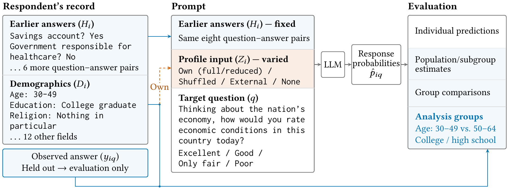

# Necessary for What? Auditing Demographic Disclosure to LLM Synthetic Respondents
[](https://www.python.org/)
[](LICENSE)



This repository contains the research code for "Necessary for What? Auditing Demographic Disclosure to LLM Synthetic Respondents" by Aspen Wang, Yen Yu Shan, and Lun-Wei Ku (Institute of Information Science, Academia Sinica).

Paper: arXiv link will be added after announcement.

# 📢 Announcements

- **2026/11** Research code. Data are not included, see 💿 below.

# 💿 Getting the data

No survey data are distributed. Create the directories below and place each source at the indicated path.

- **Pew ATP Wave 54** via [OpinionQA](https://github.com/tatsu-lab/opinions_qa) → `data/opinionqa/human_resp/American_Trends_Panel_W54/{responses,info}.csv`
- **ISSP 2023 National Identity and Citizenship (ZA10010 v1.0.0)** from [GESIS](https://www.gesis.org/en/issp/data-and-documentation/national-identity/2023), after registration → `data/issp/ZA10010_v1-0-0.dta.zip` and `data/issp/ZA10010_q_us-en.pdf`
- **2019 ACS PUMS** person and housing files from the [Census Bureau](https://www2.census.gov/programs-surveys/acs/data/pums/2019/1-Year/) → `data/acs/csv_pus.zip` and `data/acs/csv_hus.zip` (keep both archives zipped)
- **Nemotron-Personas-USA** from [Hugging Face](https://huggingface.co/datasets/nvidia/Nemotron-Personas-USA) → all eleven `train-*.parquet` shards in `data/nemotron/data/`

ISSP records are restricted. Keep them and anything derived from them local, and never send them to a hosted model.

# ⬇️ Install

```bash
python -m pip install -r requirements.txt
```

# 🤩 Using the code

## 1. Prepare respondents

Builds the respondent file and the survey instrument (targets, response sides, history bank).

```bash
python -m survey_audit.prepare_data --dataset {pew|issp} --output {respondents} --instrument-out {instrument}
```

- `--dataset`: `pew` or `issp`
- `--responses`, `--info` (Pew) or `--archive`, `--questionnaire` (ISSP): source files
- `--output`: respondent JSONL
- `--instrument-out`: instrument JSON
- `--identifiers`: optional source-to-analysis ID JSON mapping; omit it to keep public Pew `QKEY` identifiers
- `--folds`: a complete analysis-ID-to-fold JSON mapping, or the Pew `QKEY,fold` CSV below; CSV lookup uses the original `QKEY` even when `--identifiers` is supplied

`data_splits/pew_w54_analysis_sample.csv` restores the saved folds for all 1,000 analysis respondents. It contains only public `QKEY` identifiers and fold numbers 0–4. The remaining 5,088 eligible reference-training respondents retain the default deterministic folds; this file does not restore the historical full-panel training partition. A complete local `--folds` JSON mapping can restore that partition.

Example usage:

```bash
python -m survey_audit.prepare_data --dataset pew \
  --responses data/opinionqa/human_resp/American_Trends_Panel_W54/responses.csv \
  --info data/opinionqa/human_resp/American_Trends_Panel_W54/info.csv \
  --folds data_splits/pew_w54_analysis_sample.csv \
  --output work/pew_respondents.jsonl --instrument-out work/pew_instrument.json
```

## 2. Map census and persona profiles (Pew only)

Assigns each respondent one ACS person record or one Nemotron persona, mapped to the survey's categories.

```bash
python -m survey_audit.map_profiles --source {acs|nemotron} --respondents {respondents} --output {assignments}
```

- `--source`: `acs` or `nemotron`
- `--persons`, `--households` (ACS) or `--parquet-dir` (Nemotron): source files
- `--output`: assignment JSONL
- `--full-panel`: also assign profiles to reference-training respondents (default: evaluation cohort)
- `--seed`: ACS and Nemotron sampling use the default seed `20261022`

Example usage:

```bash
python -m survey_audit.map_profiles --source acs \
  --persons data/acs/csv_pus.zip --households data/acs/csv_hus.zip \
  --respondents work/pew_respondents.jsonl --full-panel \
  --output work/acs_assignments.jsonl
```

## 3. Build prompts

Writes one job per respondent, target and condition, sharing the selected history across conditions while varying the profile block.

```bash
python -m survey_audit.build_prompts --respondents {respondents} --instrument {instrument} --conditions {conditions} --output {jobs}
```

- `--conditions`: `History`, `Own`, `Shuffled` (both surveys). Pew also supports `Own_10`, `Own_7`, `Own_4`, `Shuffled_10`, `ACS_10`, `Nemotron_4`, `Nemotron_all`, `Own_political`
- `--assignments`: required for `ACS_10` and Nemotron conditions; use separate job files for the two assignment sources
- `--history-size`: requested observed-answer count (default `8`, or `all`), capped by eligible answers
- `--shuffle-seed`: seed for reassigning profiles (default `20261017`)
- `--full-panel`: include reference-training respondents; scoring still uses evaluation respondents only

Example usage:

```bash
python -m survey_audit.build_prompts --respondents work/pew_respondents.jsonl \
  --instrument work/pew_instrument.json --conditions History Own Shuffled \
  --full-panel --output work/pew_jobs.jsonl
```

## 4. Score open-weight models

Scores every option as the log-likelihood of the complete JSON answer containing its code, then normalizes across options.

```bash
python -m survey_audit.score_local --jobs {jobs} --checkpoint {snapshot} --model {model} --revision {revision} --output {predictions} --runtime {runtime-record}
```

- `--checkpoint`, `--model`, `--revision`: local snapshot and the Hugging Face ID and revision it came from
- `--answer-format`: `saved` (default), `compact` or `spaced`; saved job strings are compact for Pew and spaced for ISSP
- `--dtype`: `float32`, `float16` or `bfloat16` (default); `--device` defaults to `cuda:0`, and `--device-map auto` distributes a larger model
- `--runtime`: required JSON runtime record; `--chat-template-from` supplies a local tokenizer template override

Example usage:

```bash
python -m survey_audit.score_local --jobs work/pew_jobs.jsonl \
  --checkpoint models/qwen_2_5_7b --model Qwen/Qwen2.5-7B-Instruct \
  --revision a09a35458c702b33eeacc393d103063234e8bc28 \
  --dtype float16 --device cuda:0 --answer-format compact \
  --output work/qwen_pew.jsonl --runtime work/qwen_pew_runtime.json
```

<details>
<summary>Checkpoints and answer formats used in the paper</summary>

| Local checkpoint | Revision | Pew answer format |
|---|---|---|
| `meta-llama/Llama-3.1-8B-Instruct` | `d10aef7999a2b5ba950ab3974312feeedbfe0b77` | compact |
| `Qwen/Qwen2.5-7B-Instruct` | `a09a35458c702b33eeacc393d103063234e8bc28` | compact |
| `mistralai/Mistral-7B-Instruct-v0.3` | `c170c708c41dac9275d15a8fff4eca08d52bab71` | compact |
| `google/gemma-4-12B-it` | `707f0a3b8a3c7ad586ed01e27eafbad8a27dd0f7` | spaced |
| `allenai/Olmo-3-7B-Instruct` | `6e5971d9eba42665f5bd5a0fcf047f299ce1dccc` | spaced |
| `Qwen/Qwen3.5-9B` | `c202236235762e1c871ad0ccb60c8ee5ba337b9a` | spaced |
| `google/gemma-4-31B-it` | `842da3794eaa0b77d5f08bae87a17459d91ff475` | spaced |
| `allenai/Olmo-3.1-32B-Instruct` | `ac0587e4a7744a551c059d8cd17ba220bc940dae` | spaced |
| `Qwen/Qwen3.5-27B` | `fc05daec18b0a78c049392ed2e771dde82bdf654` | spaced |
| `meta-llama/Llama-3.1-70B-Instruct` | `1605565b47bb9346c5515c34102e054115b4f98b` | compact |
| `Qwen/Qwen2.5-72B-Instruct` | `495f39366efef23836d0cfae4fbe635880d2be31` | compact |

ISSP runs use spaced JSON for every model; for Pew, set `--answer-format` to the table entry. The three base checkpoints (Llama 8B, Qwen2.5 7B and Mistral 7B) used `--dtype float16`; the others used `--dtype bfloat16`. Llama 70B uses `--chat-template-from models/llama_3_1_8b` to reproduce its recorded template. The pinned environment uses Transformers 5.20.0; historical base-model and 70B/72B runs used 4.55.4.
</details>

## 5. Score hosted models (Pew only)

Exports requests by default, parses saved responses or makes paid API calls for Pew inputs.

```bash
python -m survey_audit.score_hosted --jobs {jobs} --provider {openai|anthropic} --model {model} --output {output}
```

- `--responses`: parse saved JSONL envelopes containing `cell_id` and `response` into predictions; request exports are not analysis inputs
- `--execute`: call the API using `OPENAI_API_KEY` or `ANTHROPIC_API_KEY`; mutually exclusive with `--responses`

Example usage:

```bash
python -m survey_audit.score_hosted --jobs work/pew_jobs.jsonl \
  --provider openai --model gpt-4.1-2025-04-14 --output work/hosted_requests.jsonl
```

## 6. Fit the statistical reference

Fits a survey-weighted, L2-regularized multinomial logistic regression for each target and condition on the supplied history and profile fields, with five-fold cross-fitting.

```bash
python -m survey_audit.fit_reference --jobs {full-panel-jobs} --conditions {conditions} --output {predictions} --audit {fit-record}
```

- `--jobs`: jobs built with `--full-panel`, so the reference trains on the full eligible panel
- `--conditions`: fitted conditions (default `History Own`); the example also fits `Shuffled`
- `--transfer-shuffled`: apply the `Own` fit to `Shuffled` inputs using `--conditions History Own`; jobs must contain `Shuffled`, and transfer predictions go in a separate output file
- `--penalties`: reuse penalties from a previous fit record; `--audit` writes the required new fit record

Example usage:

```bash
python -m survey_audit.fit_reference --jobs work/pew_jobs.jsonl \
  --conditions History Own Shuffled \
  --output work/reference_pew.jsonl --audit work/reference_pew_fits.json
```

## 7. Compute fidelity

Computes Brier score, population and subgroup TVD, and supported-pair contrast error using bootstrap draws shared across conditions and models.

```bash
python -m survey_audit.fidelity --predictions {files} --output {summary}
```

- `--predictions`: aligned prediction files for one history length; analyze the original and transferred references separately
- `--interval`: `basic` (default), `percentile` or `bca`
- `--bootstrap-repetitions`: number of draws (default `10000`)
- `--universe`: `all` (default) or `prompted` attributes for supported-pair contrasts

Example usage:

```bash
python -m survey_audit.fidelity --predictions work/qwen_pew.jsonl work/reference_pew.jsonl \
  --universe prompted --interval basic --output work/fidelity.csv
```

## 8. Classify group differences

Finds human-supported group differences and classifies each synthetic difference as reproduced, missed or reversed.

```bash
python -m survey_audit.analyze_contrasts --predictions {files} --grouping {own|shown|both} --output-dir {directory}
```

- `--predictions`: aligned predictions for one history length; include `Shuffled` for the History shown-profile comparison
- `--grouping`: `own`, `shown` or `both` (default), using respondents' own attributes or the displayed profile
- `--universe`: `all` (default) or `prompted` attributes
- `--bootstrap-repetitions`: number of draws (default `10000`)

Example usage:

```bash
python -m survey_audit.analyze_contrasts --predictions work/qwen_pew.jsonl work/reference_pew.jsonl \
  --universe prompted --grouping both --output-dir work/contrasts
```
# 📄 Citation

```bibtex
@misc{wang2026necessary,
  title         = {Necessary for What? Auditing Demographic Disclosure to LLM Synthetic Respondents},
  author        = {Wang, Aspen and Yen, Yu Shan and Ku, Lun-Wei},
  year          = {2026},
  eprint        = {XXXX.XXXXX},
  archivePrefix = {arXiv},
  primaryClass  = {cs.CY},
  doi           = {10.48550/arXiv.XXXX.XXXXX}
}
```
